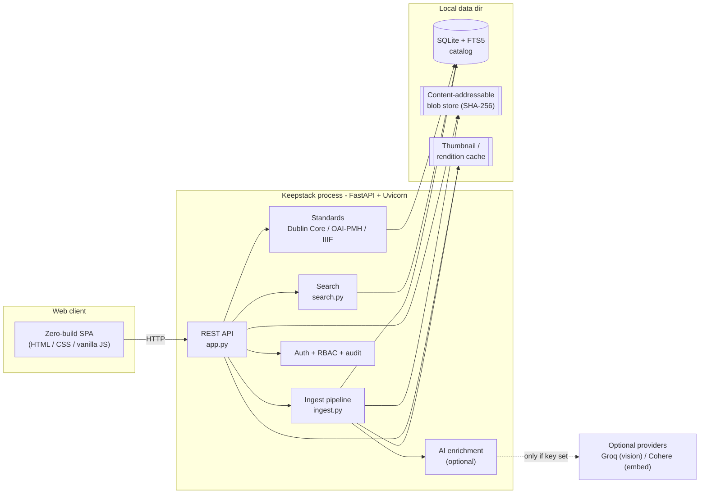
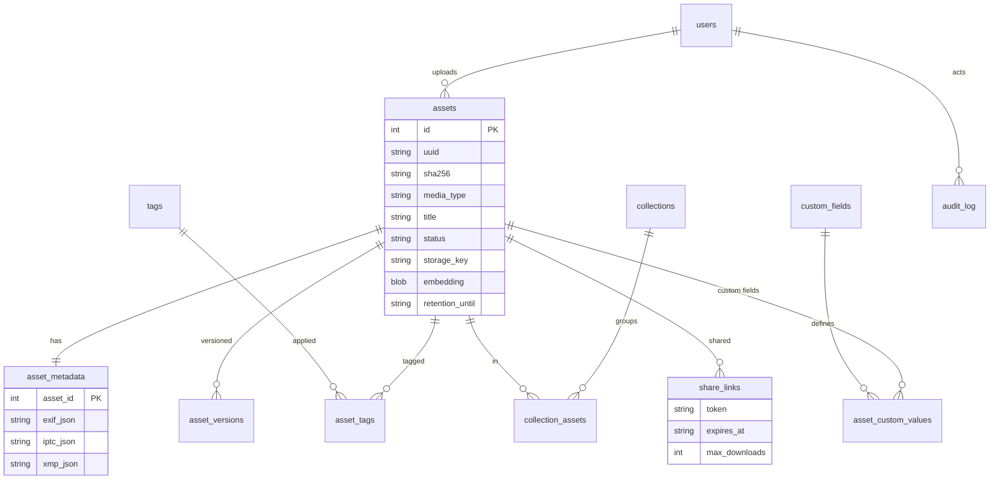
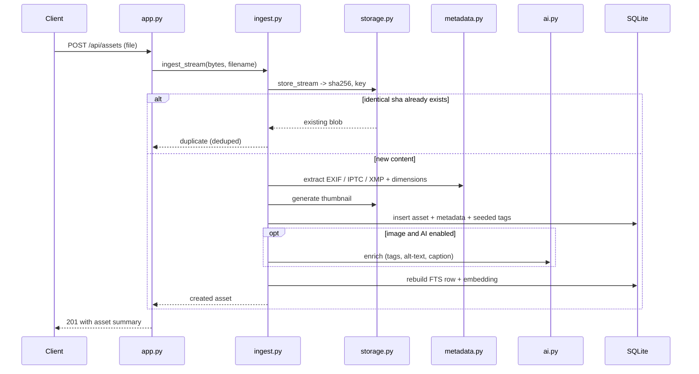
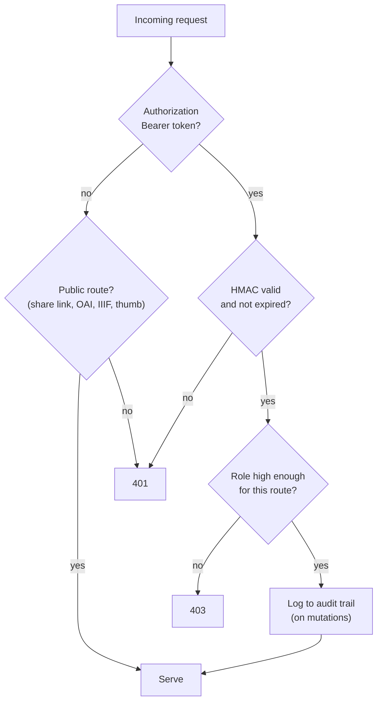

# Architecture

Keepstack is a single Python package that serves both a REST API and a zero-build
web client. It is deliberately small: one process, one SQLite database, one blob
directory, four runtime dependencies. This document explains how the pieces fit,
with diagrams that render directly on GitHub.

For the reasoning behind the big choices, see the decision records in
[docs/decisions/](docs/decisions/).

## System at a glance

Everything inside the server is stdlib except FastAPI/Uvicorn (HTTP) and Pillow
(images). No message queue, no cache server, no external database.

## Module responsibilities

| Module | Responsibility |
|--------|----------------|
| `config.py` | Environment-driven settings with safe local defaults |
| `db.py` | SQLite connection, schema, and the FTS5 full-text index |
| `storage.py` | Content-addressable blob store: dedup, fixity, retrieval |
| `metadata.py` | EXIF / IPTC / XMP extraction and descriptive-field seeding |
| `thumbnails.py` | Thumbnails and on-the-fly resized renditions (cached) |
| `ai.py` | Optional enrichment: tagging, captions, embeddings, with local fallbacks |
| `ingest.py` | The upload pipeline that ties storage, metadata, AI, and indexing together |
| `filters.py` | Normalized filter conditions, tag semantics, and filter fingerprints |
| `query.py` | Shared SQL construction for counts, list pages, and export rows |
| `pagination.py` | Signed bidirectional keyset cursor encoding and validation |
| `search.py` | Keyword, facet, cursor, and legacy semantic search entry points |
| `exports.py` | Snapshot-backed CSV generation, column allowlists, and cell safety |
| `auth.py` | scrypt passwords, stateless HMAC tokens, role hierarchy |
| `audit.py` | Append-only audit logging |
| `standards.py` | Dublin Core, OAI-PMH 2.0, IIIF Image API |
| `app.py` | FastAPI routes for every resource, and the static client mount |

## Data model

An `asset_fts` FTS5 virtual table mirrors the searchable text (title,
description, tags, metadata) and is kept in sync by the ingest pipeline.
`tag_usage` is a trigger-maintained count of active assets per tag, so the
global tag facet does not aggregate the whole `asset_tags` table on every
request.

## The ingest pipeline

The most important flow in the system. One function, `ingest_stream`, runs the
full intake so an asset is findable the moment it lands.

## Filtering, keyset pagination, and export

`GET /api/assets` builds a `FilterSpec` and then a shared SQL query. Keyword
text still uses the existing FTS5 fields and prefix tokenization, but the FTS
match is a `rowid IN (SELECT ...)` subquery instead of a join. That detail
matters: a join lets SQLite scan the status index and probe the virtual table per
asset, while the subquery lets FTS return the candidate IDs first.

Tag include conditions are correlated `EXISTS` clauses, so requiring several
tags does not duplicate result rows. Exclude conditions use `NOT EXISTS` with an
`IN` list. The current cursor page, total count, and page-boundary probes share
one read transaction.

The order is always deterministic. `newest` and `oldest` use `created_at` plus
`id`; `name` uses the coalesced title plus `id`; `largest` uses the coalesced
size plus `id`. The cursor payload carries:

- the target page and page size,
- the sort id and boundary values,
- the navigation direction,
- a SHA-256 fingerprint of the normalized filters.

The payload is HMAC-signed with the same persistent server secret used for login
tokens. A changed filter, sort, limit, or tampered token returns a 400 and the
web client starts again from page one. Legacy callers can still use `limit` and
`offset`; sending both cursor and offset is rejected.

The web toolbar reads and writes filters and sort to the URL. Cursor tokens stay
in memory because they are pagination state, not shareable search state. Page
size and CSV column preferences live in browser storage.

## CSV export

`GET /api/exports/assets.csv` accepts the same normalized filters and sort as
the list. It has no cursor and always exports every match. The server opens a
dedicated SQLite connection, starts a read transaction, counts the matches, and
rejects an oversized result before response headers. The count, row stream, and
per-batch tag lookups all see the same snapshot.

The CSV stream uses `csv.writer` with CRLF line endings and an initial UTF-8 BOM.
Required columns are always present: `uuid`, `title`, `description`, `filename`,
`media_type`, `tags`, and `created_at`. Optional public scalar columns are
limited by an allowlist, and unknown names are rejected. Multi-valued tags are
encoded as a sorted JSON array. Timestamps keep the API's ISO 8601 UTC value.

Formula-injection protection is on by default. A string cell beginning with
`=`, `+`, `-`, `@`, tab, or carriage return gets a leading apostrophe; callers
can disable that with `sanitize_formulas=false`. The export cap is
`KEEPSTACK_EXPORT_MAX_ROWS` (default 100000), and a successful export initiation
is written to the audit log. The web client downloads through an authenticated
fetch and Blob so failures can be shown instead of navigating to an error page.

## Schema migrations

The base schema and ordered migrations live in `db.py`. `schema_meta` stores
`schema_version`; `init_db` creates the base tables, then applies each pending
migration in its own transaction. Version 1 adds the keyset and tag indexes.
Version 2 adds the media facet index, `tag_usage`, its backfill, and the
triggers that maintain it when asset-tag links or asset status change. A
database newer than the running build is refused at startup.

## Request and auth flow

Tokens are stateless HMAC payloads signed with a server secret (a minimal
JWT-style scheme on the standard library), so there is no session store and no
crypto dependency.

## Why it is shaped this way

- **One process, one file.** SQLite plus a blob directory means the entire
  repository is portable and needs no separate database to run or back up. See
  [ADR-0001](docs/decisions/ADR-0001-sqlite-over-a-database-server.md).
- **Hash-keyed storage.** Deduplication and preservation fixity are the same
  mechanism. See [ADR-0002](docs/decisions/ADR-0002-content-addressable-storage.md).
- **Optional AI, never required.** The pipeline calls a provider only if a key
  is set, and falls back to deterministic local logic otherwise. See
  [ADR-0004](docs/decisions/ADR-0004-optional-offline-ai.md).

## Scaling notes and current limits

Honest boundaries of the current design:

- SQLite in WAL mode handles the read-heavy, modest-write profile of a
  self-hosted DAM well into the hundreds of thousands of assets. Very high
  write concurrency would eventually want Postgres, which the storage and query
  layers are structured to allow later.
- Semantic search currently loads candidate embeddings and ranks in Python.
  That is fine for tens of thousands of assets; beyond that it wants an ANN
  index (for example sqlite-vec or a pgvector backend). Tracked in
  [ROADMAP.md](ROADMAP.md). The web interface hides this legacy mode in favour
  of the keyword and structured-filter contract.
- Thumbnailing is synchronous in the request for now. Large video and document
  rendering would move to a background worker.
- Keyword and combined list queries are benchmarked at 100000 assets with P95
  under 500ms on the reference Windows/Python 3.10 environment; full 100k-row
  CSV export completes in about 3 seconds. The benchmark is reproducible with
  `python scripts/benchmark.py`. It is not a CI performance gate.
- CSV export is synchronous and bounds the result with a configurable row cap.
  Background jobs, per-user export quotas, and resumable downloads remain out
  of scope for this version.
